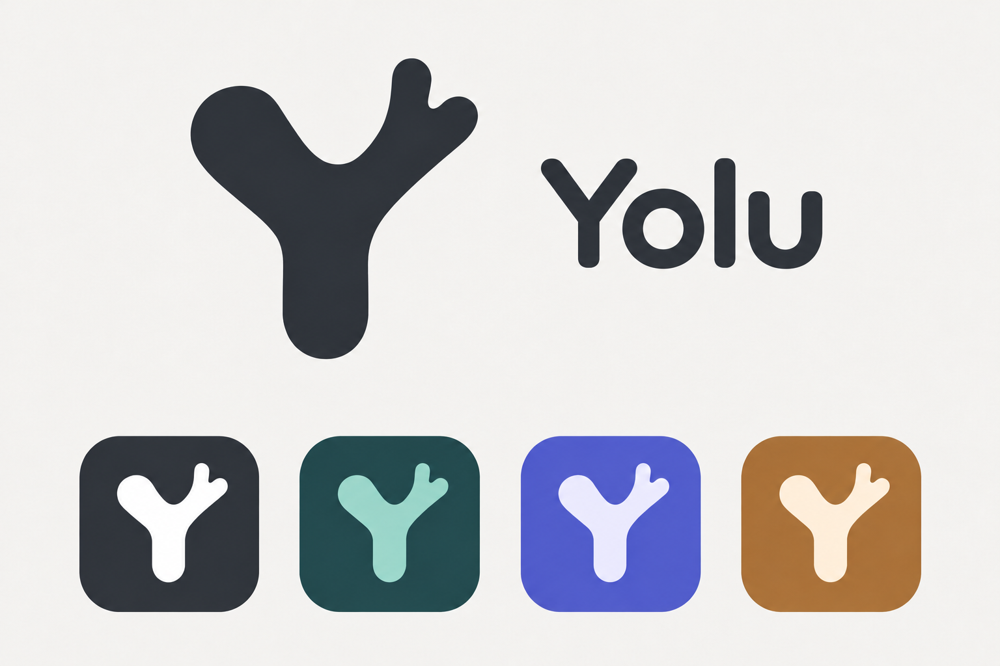

# Yolu brand reference

This directory holds the logo reference approved on November 3, 2026, and the production brand assets. The public application name is **Yolu**. See the [migration guide](migration.md) for retained data and installation identities.

## Production assets

- Vector master: [web/yolu.svg](../../../web/yolu.svg), a continuous, solid-color antler-shaped Y based on the approved reference.
- Web assets: `web/yolu.svg`, `web/yolu.png`, `web/yolu.ico`.
- Desktop assets: `src-tauri/icons/icon.png`, `icon.ico`, `icon.icns`; the startup page uses `desktop/yolu.svg`.
- After `npm ci`, run `npm run brand:icons` to regenerate platform assets with the locked Tauri CLI. Do not edit the bitmap exports independently.
- Default colors: deep teal `#203F42` and mint `#9DD8CA`. A standalone icon contains only the symbol; the UI renders the English name as text.

## Approved visual reference

The wordmark is **Yolu**, with an uppercase Y and lowercase olu. Do not add Chinese wording to the logo. Keep the asymmetrical, rounded antler-shaped Y: a broad round left arm, one short branch on the right arm and a rounded stem.

Visually center the wordmark vertically against the symbol. Letterforms should be slightly heavy with rounded ends. No specific deliverable font file has been selected for the wordmark.

The four reference treatments share one silhouette: monochrome, teal/mint, blue/violet and warm gold.

## Color reference

| Use | Color |
| --- | --- |
| Neutral symbol | Charcoal `#292D35` |
| Default background | Deep teal `#203F42` |
| Default symbol | Mint `#9DD8CA` |
| Blue/violet background | `#5964CF` |
| Blue/violet symbol | `#EEF0FF` |
| Warm gold background | `#A56F32` |
| Warm gold symbol | `#FFF4DE` |

These values are the design targets; generated PNG pixels may vary slightly. Recognition should depend on the silhouette, with background and symbol colors independently adjustable in artwork. Prefer teal/mint for release materials. The reference variants do not establish support for application theme customization or desktop icon color switching.

## Editing and generation

1. Use the actual approved reference image when generating a raster variant. Preserve the antler silhouette, branch direction and proportions.
2. Use only `Yolu` in a combined wordmark; center it visually against the symbol. Use the symbol alone for application icons.
3. Change colors without changing the shape. Prefer clean flat colors and check small sizes on light and dark backgrounds.
4. Remove speckles, broken transparency and unnecessary gradients, shadows or textures. Keep continuous edges and sufficient padding.
5. The reference PNG is an image-generation preview with multiple sizes and colors. Production packaging uses the SVG master and its generated exports, not a crop of that preview.
6. Save new approved references under versioned filenames, update this page and retain earlier approved versions.

Reusable generation brief:

> Use the attached Yolu logo as the visual reference. Preserve its asymmetrical rounded antler-shaped Y: broad rounded left arm, one short right branch and rounded stem. Keep the same silhouette and change only the requested colors or setting. For a combined wordmark, use only Yolu, with slightly heavy rounded letterforms visually centered against the symbol. Do not add Chinese text, a moon, a cabin or a deer face. Use clean flat colors, continuous edges and clear small-size padding; avoid speckles, broken transparency, texture and unnecessary shadows.
